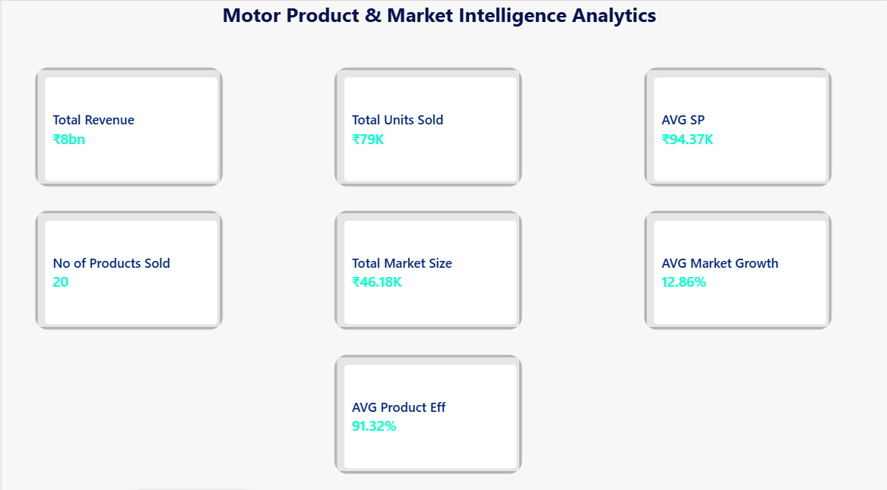

# Motor Product & Market Intelligence Analytics

## Project Overview
A Business Analyst and Power BI portfolio project focused on analyzing product performance, market opportunities, competitor positioning, and sales performance for a motor technology company using synthetic data.

## Business Problem
Management needs a consolidated view of product performance, market size and growth, competitor pricing, technical efficiency, and sales performance to support product prioritization and sales planning.

## Business Objectives
- Evaluate product performance across motor technologies and products.
- Identify industries and applications with potential market opportunities.
- Benchmark competitors on pricing and efficiency.
- Analyze sales performance across products, applications, and regions.
- Support data-driven product and market prioritization.

## Dataset
The project uses synthetic data for portfolio and learning purposes.

- Products
- Competitors
- Market Data
- Sales Performance

## Power BI Dashboard
**Page 1 — Executive Overview:** Summary of key performance indicators.
### Page 1 — Executive Overview

**Page 2 — Product & Market Analysis:** Product performance, market size, and market growth.
### Page 2 — Product & Market Analysis

**Page 3 — Competitor Analysis:** Competitor pricing, presence, and efficiency benchmarking.

**Page 4 — Sales & Opportunity Analysis:** Revenue, units sold, market growth, and selling price across regions, products, and applications.

## Tools & Skills
- Microsoft Power BI
- Power Query
- DAX
- Microsoft Excel
- Business Analysis
- KPI Development and Data Visualization

## Business Value
The dashboard provides a framework for evaluating product performance, comparing market opportunities, benchmarking competitors, and supporting sales and marketing decisions.

## Limitations
All data is synthetic. The results do not represent actual company performance or validated market intelligence.

## Project Files
- `Motor_Product_Market_Intelligence_Analytics.pbix` — Power BI dashboard
- `motor_product_market_intelligence_dataset.xlsx` — Synthetic dataset
- `BA-Documentation/` — Business Analysis documentation
- `Insights/` — Business insights and recommendations
- `Dataset/` — Dataset description

## Disclaimer
This is a portfolio project created for learning and demonstration purposes.
